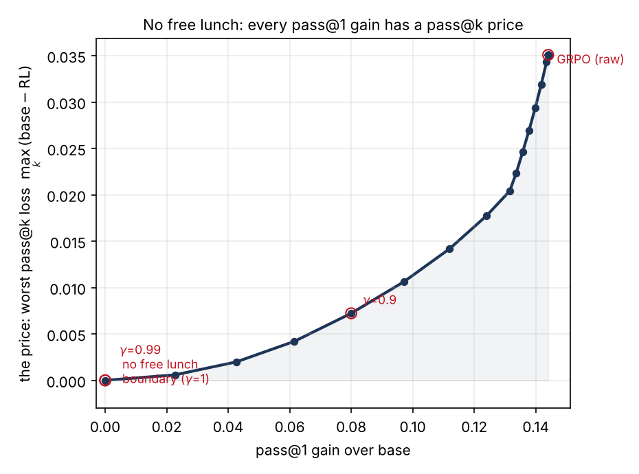
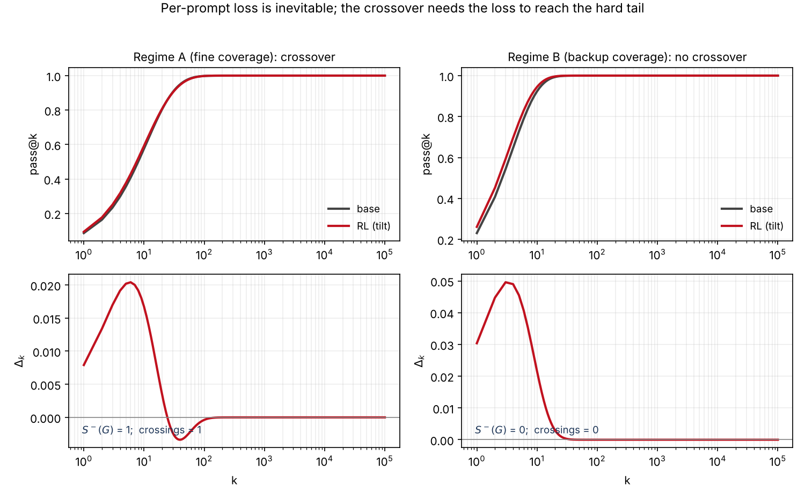

# There Is No Free Lunch in RLVR

### Every pass@1 Gain Has a pass@k Price

[](LICENSE)
[](https://www.python.org/)
[](#reproduce-every-number)
[](paper/)
[](#citation)
[](https://numpy.org/)

A solvable theory of reinforcement learning with verifiable rewards (RLVR). It
explains, and prices, the pass@k reversal: an RL-tuned model beats its base model
at pass@1 and loses to it at large k. We prove the reversal is a price, not an
artifact, and we give the exact exchange rate, a crossing bound, and a diagnostic
you can run on any evaluation log.

---

## TL;DR

* **No free lunch.** Under exclusive strategy specialization, every update that
  raises pass@1 lowers the success of at least one prompt. A strictly positive
  price on prompts (Stiemke duality) is the exact condition.
* **The pass@k price.** When the loss reaches the hardest prompts, it forces a
  pass@k crossover. The number of crossings is at most the sign variation of the
  shift in per-prompt success, a totally positive bound that is tight.
* **A frontier, not a fix.** A constrained update traces the optimal pass@1
  versus pass@k trade. Removing the crossover entirely costs the entire pass@1
  gain. There is no free lunch, only a price.
* **A diagnostic.** Two columns of per-prompt success rates (base and RL), already
  in any eval log, return the crossing bound, the order-preserving test, and the
  price.

## The price, in one figure



Every point is the best pass@1 gain achievable at a given per-prompt floor,
against the price it pays, the worst pass@k loss. The unconstrained update buys
the largest gain at the largest price; the only way to pay nothing is to gain
nothing.

## The three results

| # | Result | Statement | Verified |
|---|--------|-----------|----------|
| **Thm 2** | No free lunch | Exclusive (or dominant) specialization => every pass@1 gain lowers some prompt. Stiemke: no free lunch iff a strictly positive prompt price equalizes strategy fitness. | exclusive 1000/1000, dominant 2000/2000, primal/dual agree 100% |
| **Thm 6** | The pass@k price | #crossings <= sign variation of the success-CDF shift (Karlin). Tight. Order-preserving case recovers the known single crossover. Fine coverage => crossover forced. | 0 bound violations / 3000, tight for m=1..6, order-preserving 1035/1035 |
| **Thm 7** | The price frontier | A per-prompt floor traces the optimal pass@1 vs pass@k exchange; the strict case gives zero crossings and zero gain. | strict case 400/400, monotone trade-off |

A per-prompt loss is **unconditional**; the aggregate crossover is **conditional**
on fine coverage (the hardest prompts are covered only by below-base-average
strategies). The counterexample regime is shown and makes the claim falsifiable.



## Repository layout

```
.
├── paper/                 LaTeX source (NeurIPS preprint), compiles to the paper
│   ├── main.tex           title, abstract, inputs the section bodies + bibliography
│   ├── sec{1..7}_body.tex Model, No Free Lunch + Price, Tilt law, Published curves,
│   │                      Related work, Introduction, Appendix (proofs)
│   ├── references.bib     102 references
│   ├── neurips_2024.sty   PLACEHOLDER style (replace with the official one)
│   ├── main.bbl           pre-built bibliography (compiles without bibtex)
│   └── figures/           the four paper figures
├── src/                   verification code, one script per result
│   ├── common.py          model, tilt dynamics, pass@k, sign-variation utilities
│   ├── t_star.py          Thm 2: Stiemke, exclusive/dominant specialization, fine coverage
│   ├── t5_passk_crossover.py  Thm 6: crossing bound, tightness, uniqueness
│   ├── c6_correction.py   Thm 7: the price frontier (constrained update)
│   ├── t1_t3_t4_bridge.py tilt identity, entropy identity, tilt law, token vs strategy
│   ├── t2_t6.py           sharing necessity, group size
│   ├── diagnostic.py      the read-off tool (use on your own eval)
│   ├── empirical.py       anchor on published pass@k curves
│   ├── paper_figures.py   regenerates figures 1-4
│   ├── check_numbers.py   verifies every number cited in the paper
│   └── run_all.py         regenerate everything, then verify
├── results/               results/*.json produced by the scripts
├── figures/               rendered figures (used by this README and the paper)
├── requirements.txt
├── CITATION.cff
└── LICENSE
```

## Installation

```bash
git clone https://github.com/yliusci/no-free-lunch-rlvr.git
cd no-free-lunch-rlvr
pip install -r requirements.txt
```

Requirements: Python 3.10+, NumPy, SciPy, Matplotlib. CPU only. No model is run
and no data is collected.

## Quickstart: the diagnostic

Run the read-off tool on your own base-vs-RL evaluation. The input is the per
prompt success rates (or the pass@k curves they induce), which any eval log
already contains.

```python
# from the repo root: cd src
import numpy as np
from diagnostic import report_from_success

# per-prompt base and RL success probabilities over your prompt set
p_base = np.array([0.40]*700 + [0.02]*300)
p_rl   = np.array([0.60]*700 + [0.004]*300)

print(report_from_success(p_base, p_rl))
# -> {'n_crossings': 1, 'crossing_ks': [...],
#     'regime': 'order-preserving sharpening (Yue/Yang-Chen regime): RL wins small-k, loses large-k',
#     'karlin_bound_Sminus_G': 1, 'bound_respected': True, 'bound_saturated': True}
```

You can also pass pass@k curves directly:

```python
from diagnostic import report_from_curves
ks     = [1, 4, 16, 64, 256]
base   = [0.102, 0.224, 0.392, 0.578, 0.691]
rl     = [0.251, 0.368, 0.496, 0.608, 0.683]
print(report_from_curves(ks, base, rl))   # detects the single crossing between k=64 and 256
```

Report two numbers alongside pass@1 and pass@k in your own results: **the price**
(worst pass@k loss) and **the crossing count**. Both are read from an eval log at
no additional compute.

## Reproduce every number

```bash
cd src
python run_all.py          # regenerate results/*.json and figures, then verify
python check_numbers.py    # 34/34 invariants; exit 0 means all hold
```

Fixed seeds throughout. `check_numbers.py` recomputes and checks every constant
quoted in the paper, including the Stiemke primal/dual agreement, the crossing
bound, the frontier, the fine-coverage dichotomy, and the published-curve anchor.

## Compile the paper

The bibliography is pre-built, so two LaTeX passes suffice:

```bash
cd paper
pdflatex main.tex && pdflatex main.tex
```

To rebuild the bibliography: `pdflatex main && bibtex main && pdflatex main && pdflatex main`.
The style file `neurips_2024.sty` here is a placeholder so the paper compiles
anywhere; replace it with the official NeurIPS style before submission.

## How it works

RLVR is modeled, in the population limit, as an exponential tilt of a base policy
over solution strategies shared across prompts:

```
w_tau(j)  ∝  w_0(j) * exp(tau * f_j),     f_j = E_x[ q_{xj} ]
```

where `q_{xj}` is the probability that strategy `j` solves prompt `x`. Per-prompt
success is `p_x = <w, q_x>`, pass@1 is `<w, f>`, and pass@k averages
`1 - (1 - p_x)^k`. The single tilt identity drives both the entropy side studied
in prior work and the pass@k price proved here. Probability on the simplex is
conserved, so reinforcement spends it; under specialization the spending is
visible at the level of prompts, which is the source of the crossover.

## Caveats

* The empirical anchor (published pass@k curves) is **indicative**: the values are
  transcribed from the source tables and should be re-checked before any strong
  claim. The theory is about a model, not about any specific language model
  beyond what published curves show.
* `neurips_2024.sty` is a placeholder, not the official style file.
* arXiv identifiers in `references.bib` were verified against arxiv.org by an
  automated pass; re-check author lists before camera-ready.

## Citation

```bibtex
@article{liu2026nofreelunch,
  title   = {There Is No Free Lunch in RLVR: Every pass@1 Gain Has a pass@k Price},
  author  = {Liu, Yinuo},
  year    = {2026},
  journal = {arXiv preprint}
}
```

## License

MIT, see [LICENSE](LICENSE).
